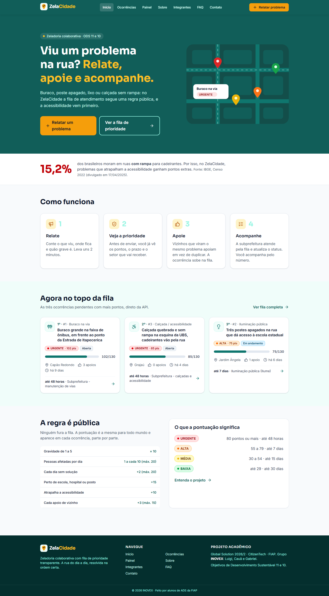

# ZelaCidade · Zeladoria colaborativa com fila de prioridade

> Global Solution 2026/2 · **CitizenTech** (categoria Cidades · ODS 11 e 10) · FIAP · Front-End Design Engineering · Grupo **INOVEX**



## Objetivo
O cidadão relata problemas do bairro: buraco, poste apagado, lixo, calçada sem rampa, bueiro entupido. Os vizinhos **apoiam** a mesma ocorrência em vez de duplicar o registro. O sistema calcula uma **prioridade transparente** e mostra a **fila de atendimento** para a prefeitura, com prazo recomendado e setor responsável.

As regras de prioridade são as mesmas do motor em Python do grupo, ficam em [`src/utils/prioridade.ts`](src/utils/prioridade.ts) e somam:
- gravidade × 10;
- +1 a cada 10 pessoas afetadas (máx. 20);
- +2 por dia sem solução (máx. 20);
- +15 perto de escola, hospital ou posto;
- +10 se afeta a acessibilidade;
- +3 por apoio (máx. 15).

Com 80 pontos ou mais a ocorrência é **URGENTE** (48 h); de 55 a 79, **ALTA** (7 dias); de 30 a 54, **MÉDIA** (15 dias); abaixo de 30, **BAIXA** (30 dias).

## Links
| O quê | URL |
|---|---|
| Repositório GitHub | https://github.com/LuigiT2703/gs-front |
| Deploy na Vercel | https://zelacidade-taupe.vercel.app |
| API Java (Render) | https://zelacidade-api.onrender.com |
| Vídeo (YouTube) | https://youtu.be/xjP_Cple_vQ |

## Tecnologias
- **React 19 + Vite 8 + TypeScript** (modo `strict`)
- **Tailwind CSS 4**: toda a estilização, escrita do zero, sem template nem kit de componentes
- **React Router 7**: rotas estáticas, rota com parâmetro (`/ocorrencias/:id`) e página 404
- **React Hook Form**: validação dos formulários
- **lucide-react**: só ícones
- **fetch** nativo para todas as chamadas da API (sem axios), em `src/services/`

## Páginas e rotas
| Rota | Página | Usa a API? |
|---|---|---|
| `/` | Home (com o topo da fila ao vivo) | GET `/ocorrencias` |
| `/ocorrencias` | Fila de prioridade com filtros (bairro, categoria, status e prioridade) | GET `/ocorrencias` |
| `/ocorrencias/nova` | Registrar ocorrência (formulário + prévia da prioridade) | POST `/ocorrencias` |
| `/ocorrencias/:id` | Detalhe: pontos explicados, apoiar, atualizar status, histórico e excluir | GET, POST `/apoios`, GET e POST `/atualizacoes`, DELETE |
| `/painel` | Painel da prefeitura (totais, por bairro, por categoria, topo da fila) | GET `/ocorrencias` |
| `/sobre` · `/integrantes` · `/faq` · `/contato` | Páginas institucionais | — |
| qualquer outra | 404 | — |

Toda tela que usa a API tem os estados **carregando** (com aviso da demora do Render), **erro de requisição** (com "Tentar de novo") e **ausência de dados**. Os erros 400, 404 e 409 mostram a `mensagem` enviada pela API.

## Estrutura de pastas
```
zelacidade-front/
├── src/
│   ├── components/   # Header, MenuMobile, Footer, Layout, Logo, CardOcorrencia, BadgePrioridade, BadgeStatus,
│   │                 # BarraPrioridade, Carregando, ErroRequisicao, EstadoVazio, Mensagem, Campo, DialogoConfirmacao,
│   │                 # FormApoio, FormStatus, HistoricoAtualizacoes...
│   ├── pages/        # Home, Ocorrencias, OcorrenciaDetalhe, RegistrarOcorrencia, Painel, Sobre, Integrantes, Faq, Contato, NaoEncontrada
│   ├── services/     # api.ts (requisição base com fetch + ErroApi) e ocorrenciasService.ts
│   ├── types/        # Ocorrencia, NovaOcorrencia, Atualizacao, ErroApiCorpo, Categoria, StatusOcorrencia...
│   ├── utils/        # regras de prioridade, formatação e ajudantes de formulário
│   ├── data/         # integrantes, FAQ e links do menu
│   ├── routes.tsx
│   └── main.tsx
├── public/           # favicon (logo em SVG) e fotos dos integrantes (public/integrantes/)
├── docs/             # prints, TELAS_E_UX.md, ROTEIRO_VIDEO.md, GUIA_APRESENTACAO.md
├── CONTRATO_API.md   # contrato da API Java que o front consome
├── .env.example
└── vercel.json       # rewrite para /index.html (F5 em rota interna)
```

## Como rodar
Pré-requisito: **Node 20 ou mais novo**.
```bash
npm install
cp .env.example .env      # no Windows: copy .env.example .env
npm run dev               # abre em http://localhost:5173
```
- No `.env`, coloque em `VITE_API_URL` a URL da API Java, sem barra no final. Exemplo: `VITE_API_URL=https://zelacidade-api.onrender.com`.
- Build de produção: `npm run build`. Para ver o build: `npm run preview`.

### Deploy na Vercel
1. Importe o repositório na Vercel. O framework detectado é Vite.
2. Em *Settings → Environment Variables*, crie `VITE_API_URL` com a URL da API.
3. O `vercel.json` já faz o rewrite para `/index.html`, então o F5 em `/ocorrencias/3` funciona.
4. Na API Java, libere no **CORS** a URL da Vercel e o `http://localhost:5173`.

## Integrantes
| Foto | Nome | RM | Turma | GitHub | LinkedIn |
|---|---|---|---|---|---|
|  | Luigi Tormim Carqueijeiro | RM572424 | 1TDSPH | [LuigiT2703](https://github.com/LuigiT2703) | [LinkedIn](https://www.linkedin.com/in/luigi-tormim-b64738393) |
|  | Cauã De Souza Vasconcellos | RM573349 | 1TDSPH | [cauadesouzavasconcellos-byte](https://github.com/cauadesouzavasconcellos-byte) | [LinkedIn](https://www.linkedin.com/in/cau%C3%A3-souza-b92261395) |
|  | Gabriel Soares Tavares | RM571113 | 1TDSPV | [gabristavares](https://github.com/gabristavares) | [LinkedIn](https://www.linkedin.com/in/gabrielst1005) |

## Decisões de design (visual autoral)
- **Direção "Cidade cuidada":**
  - verde-petróleo (`#115E59` e `#0F766E`) passa confiança e lembra uma cidade cuidada;
  - o âmbar (`#F59E0B`) destaca as ações principais;
  - as fontes são Sora (títulos) e Inter (texto).
  - É a mesma identidade do PDF de Engenharia de Software e dos slides do pitch.
- **Prioridade sempre com as mesmas cores:** URGENTE vermelho, ALTA laranja, MÉDIA amarelo e BAIXA verde, sempre com texto escuro sobre fundo claro para manter o contraste AA. O ponto colorido ajuda quem não distingue cores.
- **Barra de pontos:** mostra de onde vem cada ponto, para cumprir a promessa de "regra pública".
- **Ilustrações:** o logo, o mapa da Home e a ilustração de estado vazio foram desenhados à mão em SVG.
- **Acessibilidade:**
  - `label` em todos os campos e `aria-describedby` ligando o campo à dica e ao erro;
  - foco visível em âmbar e link "Pular para o conteúdo";
  - `<dialog>` nativo para confirmar exclusão;
  - respeito a `prefers-reduced-motion`.
- **Referências usadas só como inspiração (nenhum código copiado):**
  - o Design System do Governo Federal (gov.br), pela clareza dos formulários e pelos estados de mensagem;
  - Colab e SP156, pelo fluxo de relato de zeladoria;
  - FixMyStreet, pela ideia de evitar duplicadas;
  - landing pages de serviço público no Land-book e no Dribbble, pela hierarquia do hero.

  O detalhamento está em [`docs/TELAS_E_UX.md`](docs/TELAS_E_UX.md).

## Testes realizados
- `npm run build` sem erros de TypeScript.
- Testes automatizados com Playwright (60 verificações):
  - todas as páginas em 390×844, 768×1024 e 1440×900, sem rolagem horizontal (`scrollWidth <= clientWidth`);
  - menu mobile abrindo, navegando e fechando;
  - GET, POST, DELETE, apoio e atualização de status;
  - erros 400, 404 e 409 com mensagem amigável;
  - estados de carregando, erro e vazio;
  - validação dos 3 formulários;
  - F5 em rota interna.
- Os prints estão em [`docs/prints/`](docs/prints/).

> **Importante:** os testes de integração rodaram contra um servidor local de teste que segue o [`CONTRATO_API.md`](CONTRATO_API.md), porque a API Java ainda não estava publicada. O código do front **não tem mock**: ele chama somente a URL de `VITE_API_URL`.
